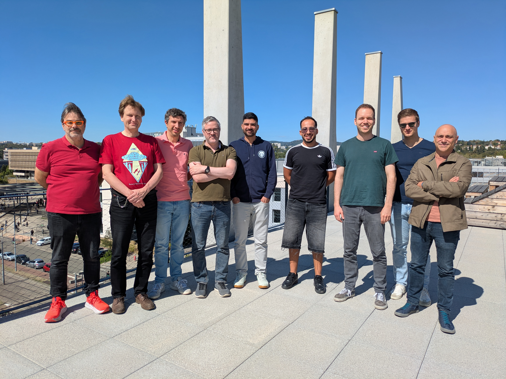
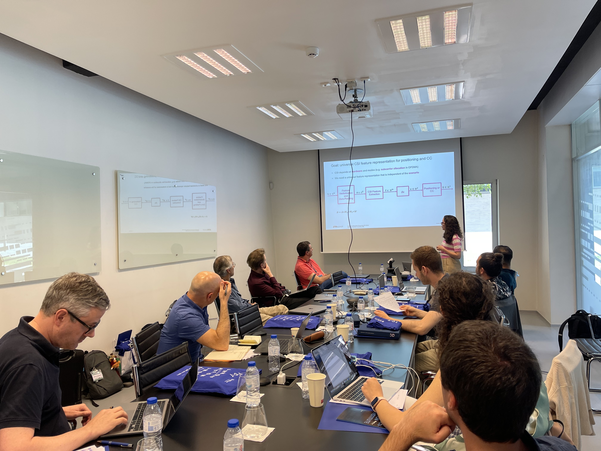

### 10.09.2026 - In-Person Meeting in Lyon, France
Today, the project partners met in Lyon, France, for the concluding in-person meeting of the project. The meeting was kindly hosted by Maxime Guillaud at Inria. Looking back on almost three years of close collaboration, the participants presented their latest results and reflected on what the project has achieved together, from the synthetic and real-world CSI datasets to new methods for distributed and online channel charting and a channel charting API. Everyone was very pleased with the progress made and the many developments that came out of the collaboration. The meeting ended with lively discussions on open research questions and ideas for continuing the exchange between the groups beyond the end of the project.

  

### 11.06.2024 - In-Person Meeting in Guimarães, Portugal
Today, all parties of the project came together for the second in-person meeting since the project started last year. The meeting was kindly hosted by Professor Adriano Moreira at his home institution, the University of Minho in Portugal. On the agenda were status updates on the groups' work on synthetic CSI datasets as well as real-world CSI data acquisition. Additionally, the participants presented recent developments in distributed and online channel charting and discussed further scenarios that could benefit from channel charting as a service. 

  
  

### 15.11.2023 - Project Kick-Off
The members of the project met for the official kick-off event in Zurich, Switzerland.
